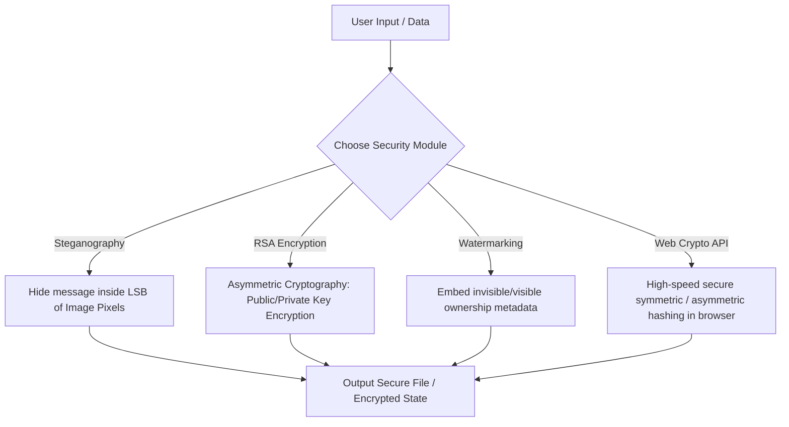

# 🔐 Secure Steganography & Cryptography Suite

[](https://crypto-stego.netlify.app/)
[](https://opensource.org/licenses/MIT)
[](https://developer.mozilla.org/en-US/docs/Web/JavaScript)
[](https://crypto-stego.netlify.app/)

A comprehensive, interactive web platform implementing advanced data privacy, verification, and encryption tools. This suite features real-time **Image Steganography**, **RSA Key Generation & Cipher suites**, **Digital Watermarking** for copyright protection, and secure **Web Crypto API** implementations directly inside the browser.

🔗 **Try the live app here:** [https://crypto-stego.netlify.app/](https://crypto-stego.netlify.app/)

---

## 🚀 Key Modules & Features



### 🖼️ 1. Image Steganography (LSB Method)
* **Message Encoding:** Embeds encrypted or plain text secret messages within the Least Significant Bits (LSB) of image pixels without distorting the visual quality.
* **Message Decoding:** Upload an encoded stego-image to parse pixel channels and reveal hidden data.
* **Lossless Rendering:** Utilizes HTML5 canvas to maintain image integrity during payload injection.

### 🔑 2. RSA Cryptographic Suite
* **Interactive Keypair Generation:** Generate public and private keys (up to custom bit lengths) in real time.
* **Cipher Engine:** Encrypt sensitive text blocks with a recipient's public key and decrypt the resulting ciphertext using the matching private key.
* **Step-by-step Math Visualizer:** Perfect for educational use, displaying how modulus and exponent arithmetic operate behind the scenes.

### 🏷️ 3. Digital Watermarking
* **Ownership Embedding:** Digitally overlay authenticating metadata or logos onto intellectual properties.
* **Copyright Protection:** Defend assets against unauthorized redistribution.
* **Tamper Verification:** Assess if an image file has been altered since watermarking.

### ⚡ 4. Modern Web Crypto API
* **Native Speed & Security:** Utilizes the browser's hardware-accelerated `window.crypto.subtle` API.
* **Cryptographic Primitive support**: Demos fast, military-grade algorithms like AES-GCM, SHA-256 hashing, and PBKDF2 key derivation directly on the client side.

---

## 🛠️ Tech Stack & Dependencies

* **Frontend Structure:** HTML5 (Semantic elements)
* **Styling & UI:** Modern Vanilla CSS3 with responsive glassmorphism themes
* **Client-Side Logic:** Vanilla JS (ES6+) utilizing Canvas API & Browser Web Crypto APIs
* **Desktop Core (Optional):** Java backend implementations for offline batch cryptography operations

---

## 📁 Repository Structure

```directory
├── assets/                  # Graphics, banners, and icons
├── docs/                    # Technical documentation, flowcharts, and academic reports
└── src/                     # Source code directory
    ├── html/                # Web app interface templates
    │   ├── index.html       # Landing page / hub
    │   ├── rsa.html         # RSA cryptosystem simulator
    │   ├── steganography.html # LSB Steganography suite
    │   ├── watermark.html   # Digital watermarking dashboard
    │   └── webcrypto.html   # Web Crypto API engine
    ├── css/                 # Custom layout & design components
    ├── js/                  # App controllers and algorithms
    └── java/                # Command Line / Desktop cryptographic tools
```

---

## ⚙️ Quick Start

No complex dependencies or compilers required. Because this suite uses client-side web technologies, you can run it instantly:

1. Clone this repository:
   ```bash
   git clone https://github.com/saihardhikreddy/steganography-and-watermarking.git
   ```
2. Navigate to the project root and launch the main portal:
   - On Windows: Double-click `src/html/index.html` or open it with your browser.
   - Using VS Code: Right-click `index.html` and choose **Open with Live Server**.

---

## 🔮 Feature Roadmap & Status

* [x] **LSB Image Steganography:** Embed and decode encrypted payloads inside image pixels using HTML5 canvas.
* [x] **RSA Cryptographic Suite:** Asymmetric keypair generation and step-by-step math visualization.
* [x] **Digital Watermarking:** Overlay ownership metadata for copyright protection and tamper verification.
* [x] **Web Crypto API Engine:** Hardware-accelerated client-side AES-GCM and SHA-256 cryptographic primitives.
* [ ] **AI-Assisted Steganalysis:** Pixel distribution histogram checks to detect hidden payloads.
* [ ] **Frequency Domain (DWT/DCT) Steganography:** Frequency transform embedding for JPEG compression resistance.
